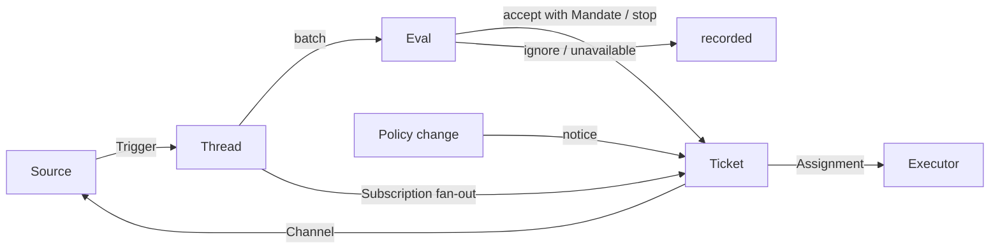

<a id="001-domain-model"></a>

# 001 领域模型

> 原文版权：Copyright (c) 2026 DeepSeek Harness Team；MIT License。
> [英文原文](https://github.com/deepseek-ai/dsh-superagent-prototype/blob/6337fc823ce20251c8de8085948165c81aaa701e/docs/001-domain.md) · 固定版本：`6337fc823ce20251c8de8085948165c81aaa701e`  
> 中文翻译，非官方；代码与配置保持原样。

本文为 dsh-superagent 中的概念命名，并说明每个概念维护的规则。代码、Agent 调用的工具、面板以及其他文档都只使用这些术语。遵循 [000 设计理念](000-philosophy.md)，模型只保留工作所需的概念，业务需求则成为其中某个概念的属性。

<a id="flow"></a>

## 流程

工作从触发（Trigger）进入评估（Eval），再进入执行。来源（Source）产生触发。触发会作为上下文，扇出到订阅了其所属线程（Thread）的工单（Ticket）。人的消息如果通过这种方式到达某个工单，就留在该工单中；其他触发则进入评估，由评估判断它是否要求开展新工作。评估决定接单时，会创建带有授权（Mandate）的工单。派工（Assignment）将工单交给执行器（Executor），结果则通过渠道（Channel）返回来源。



<a id="concepts"></a>

## 概念

来源、线程、评估、授权和订阅构成核心领域，其余概念为它们提供支持。

| 概念 | 定义 | 维护的规则 | 存在的原因 |
| --- | --- | --- | --- |
| 来源（Source） | 一条事件流。来源类型是可复用的实现；来源实例是某种类型的一份配置，包括是否运行以及监听什么 | 保存自己的读取位置和机器人身份。定义什么算作事件，也包括只有经过一段时间才成立的条件。在触发进入领域之前，丢弃机器人自己的消息和监听范围之外的触发。将每个触发转换成它所属的线程，以及可用于回复的渠道地址 | 重启不能重放事件 |
| 触发（Trigger） | 一个不可变事件，带有来源自己的元数据，例如行为发起者 | 属于一个或多个线程。同一个触发被接单两次，也只创建一个工单 | 审计与幂等性的单位 |
| 线程（Thread） | 按时间排列的触发；哪些触发组成一个线程，由来源定义 | 同一时间最多运行一次评估。可以有多个工单。保存自己的订阅、正在运行的评估以及决定历史 | 为评估提供一致的视图及其上下文 |
| 关联（Correlation） | 同一个触发所归属的多个线程之间的关系 | 增加上下文；绝不负责路由 | 让评估能够追踪相关证据 |
| 渠道（Channel） | 线程的写入端；地址由来源定义 | 一个线程可以有多个渠道；工单保存一组渠道 | 确认消息、回复、拉取请求以及解决审查讨论，都属于写入 |
| 策略（Policy） | 带版本的研判规则，以及每个来源自己的部分：谁可以通过该来源发起工作、这些人在该来源中的身份、名单如何同步，以及哪些机器人可以产生候选触发 | 策略版本覆盖规则、接单模式以及各来源部分。影响进行中工单的变更，例如修改了它接单时依据的规则，会送达其派工；这不会撤销授权。不同来源的身份绝不互相映射 | 规则改变时，必须丢弃正在运行的评估 |
| 评估（Eval） | 对一批触发作出的判断，分为准入和研判两层 | 输入包括：触发批次、线程快照、线程上的所有工单（包括已结束的工单），以及当前策略。输出为一个决定。不保存状态 | 决定新工作是否开始、继续或停止 |
| 授权（Mandate） | 接单所授予的内容：策略版本、范围、强度、匹配的规则、发送者在该来源中的身份，以及来源如何收到这个触发 | 不可变；扩大范围意味着新建工单。工单结束并不会使授权终止：只有人发出的停止请求会撤回授权，而不再支持该授权的策略会使其被撤销。已结束的工单恢复前，要根据当前策略重新验证授权 | 说明为什么允许开展这项工作，以及可以推进到哪里 |
| 工单（Ticket） | 一项已获授权的工作 | 只能由评估创建。引用其授权，保存自己的渠道和输入。状态从 open → ended；当人在其某个线程上的消息使它恢复时，又会回到 open，除非此前是人要求停止。它定义自己的状态，而不是跟随执行器的状态 | 负责执行及其报告 |
| 派工（Assignment） | 工单与某个执行器实例之间的绑定 | 一个工单在不同时期可以有多个派工。独立于工单，按 pending → running → ended 转移状态。从执行器一侧，只有最终报告可以结束工单 | 执行器在领域之外，但由谁执行必须属于领域内部 |
| 订阅（Subscription） | 工单与线程之间的多对多关系，由线程保存 | 匹配的触发会扇出到每个尚未结束的订阅工单，不检查发送者是谁；人的消息若以这种方式到达工单，不经过评估。执行器为获取上下文而关注的线程，也用同样的方式到达其工单，但不会赋予工单任何权限，也不会使它恢复。已结束的工单保留订阅，包括已关闭或已合并的拉取请求的订阅：人的消息会在原授权下使其恢复，不经过评估，也不产生决定；机器人和 CI 的消息不会到达它，因为执行器恢复时会重新读取其线程。人已要求停止的工单不再接收任何内容。只有在消息明确指向某个现有工单时，主 Session 才会把线程附加到该工单。人可以删除某个线程上的全部订阅；执行器只能删除自己工单对某个无关线程的订阅，而且不能删除工单的起始线程订阅，也不能删除来源要求它关注的线程订阅，例如其拉取请求所在的线程 | 后续讨论无需再次提及 Agent，就能到达执行器 |

人不是领域概念。触发携带来源提供的行为发起者标识符。允许名单是策略中属于某个来源的部分，使用该来源的身份标识。同一个人在多个来源上有账号，这类信息以提示词文本的形式提供给 Agent，在需要时读取。

执行器及其 Session 和目录都在领域之外，通过派工与领域连接。

聚合关系如下：来源保存自己的读取位置。线程保存订阅、正在运行的评估，以及决定历史；评估串行运行，运行期间新到的触发会合并进下一个批次。工单保存自己的派工、渠道和输入，并通过 id 引用决定。

<a id="rejected-concepts"></a>

## 被舍弃的概念

| 被舍弃的概念 | 原因 |
| --- | --- |
| 将 Principal 或 Membership 建模为实体，或在来源之间映射身份 | 人是触发的元数据；允许名单是策略中属于某个来源的部分；跨来源的映射是提示词文本 |
| 评估自己调度延迟触发 | 需要等待的条件就是一个普通来源，因此评估永远不需要反过来依赖来源 |
| 评估的 waiting 或 revoked 状态 | 等待属于来源；超时的评估会将触发重新入队，或者以 `unavailable` 结束 |
| 每个线程最多有一个尚未结束的工单 | 一个线程可以承载多项相互独立的工作；研判会根据工单列表避免重复 |
| “追加到工单”这种决定 | 追加由订阅扇出完成，不需要评估 |
| 对订阅进行准入检查 | 订阅覆盖整个线程；授权将权限与上下文分开 |
| 能够路由的关联 | 订阅负责路由；关联只增加上下文 |
| 跟随 DSH Session 的工单状态 | 工单可以被移交、恢复，或者由多个执行器运行，因此它需要定义自己的状态 |
| 执行器自行声明有人要求它停止 | 只有评估能决定一次结束的强度 |
| 策略变化时取消正在运行的工单 | 取消正在进行的工作会留下半成品；因此改为记录并送达策略变更 |
| 执行器失败或受阻时，锁住其 Session 的所有工具 | 这会阻止人直接在 Session 中工作，也会阻止恢复后的报告；暂停自动输入就足够了 |
| 从报告的自由文本推断“正在等人” | 这种分类需要结构化事实；执行器通过结构化字段提问 |

<a id="what-is-reusable"></a>

## 哪些部分可以复用

上述概念及其规则可以复用。来源实现、策略内容、执行器和渠道实现则属于具体部署。每个来源在内部保留自己的词汇，例如消息、聊天或通知，再将它们转换为触发。

| 部分 | 本仓库中的实现 |
| --- | --- |
| 来源 | 飞书：实时事件、历史恢复，以及对已订阅话题的轮询。GitHub：通知、已订阅的 Issue 和拉取请求、CI 变化、拉取请求合并或关闭；如果开启相应功能，还包括仓库中的每个新 Issue、拉取请求和评论，以及默认分支的 CI |
| 策略 | 研判规则，以及每个来源的允许名单、同步方式、机器人名单和准入表 |
| 执行器 | 每个工单对应一个 DSH 执行器 Session 和一个目录；其执行环境中的变量由执行器和来源注册 |
| 渠道 | 飞书话题回复、GitHub 评论和审查线程回复 |

<a id="glossary"></a>

## 术语表

以下列出本文及后续文档使用的术语及其中文名称；尚未在上文介绍的术语，会在后面的文档中解释。面板一次只显示一种语言；点击其中的 (?) 按钮，会打开同时显示两种语言的术语表。Agent 在 GitHub 和飞书上发给人的消息使用通俗语言，而不是这些术语。

| 术语 | 中文 | 含义 |
| --- | --- | --- |
| Agent | 智能体 | dsh-superagent 运行的自动化团队成员，通过 GitHub 账号和飞书机器人等身份在来源上采取行动 |
| Main Session | 主 Session | 负责评估触发、接单、派发工单和回复的 DSH Session；在代码和提示词中称为 `orchestrator` |
| Executor Session | 执行器 Session | 执行器为一个工单运行的 DSH Session；在代码和提示词中称为 `worker` |
| Source | 来源 | 一条事件流：由插件提供的类型，加上一份实例配置 |
| Trigger | 触发 | 来自某个来源的一个不可变事件 |
| Thread | 线程 | 按时间排列的触发；同一时间只运行一次评估的单位 |
| Correlation | 关联 | 共享同一个触发的线程之间的关系；它只增加上下文 |
| Channel | 渠道 | 线程的写入端 |
| Policy | 策略 | 带版本的接单规则，以及每个来源的策略部分，例如谁可以在那里请求工作 |
| Policy version | 策略版本 | 规则、来源部分和接单模式的一种组合的标识符；每份授权都会记录它 |
| Eval | 评估 | 将一批触发转换为决定的过程 |
| Gate | 准入 | 评估中确定性的第一层：谁可以发起工作，以及依据的强度 |
| Assessment | 研判 | 模型在评估期间作出的判断 |
| Decision | 决定 | 评估的结果 |
| Mandate | 授权 | 接单所授予的内容：强度、范围，以及所依据的策略版本 |
| Ticket | 工单 | 一项已获授权的工作 |
| Assignment | 派工 | 工单与某个执行器实例之间的绑定 |
| Subscription | 订阅 | 工单与线程之间的关系 |
| Fan-out | 扇出 | 将已订阅线程中的触发送入工单，作为上下文 |
| Executor | 执行器 | 运行派工的端口：每个工单对应一个执行器 Session 和一个目录 |
| Execution environment | 执行环境 | 执行器 Session 和准备命令运行所在的环境：变量由执行器和来源注册，每个变量都有键、值和说明 |
| Report | 报告 | 派工向其工单汇报的状态 |
| Attention | 待人工决定 | 工单上等待人回答的问题 |
| Disposition | 去向 | 记录一个触发是被过滤、被评估，还是被扇出 |
| Input | 输入 | 送入工单的上下文：扇出的触发、策略变更、恢复事件以及文本 |
| Scope | 范围 | 授权允许开展的工作 |
| Strength | 强度 | 授权或评估所依据的理由有多强 |

| 分组 | 取值 |
| --- | --- |
| 决定 | accept 接单 · stop 停止 · ignore 忽略 · unavailable 未完成 |
| 强度 | explicit 明确 · inferred 推断 |
| 派工 | pending 待启动 · running 执行中 · ended 已结束 |
| 报告 | progress 进展 · waiting 等待 · ready 就绪 · blocked 受阻 · failed 失败 · dropped 无需处理 |

<!-- original-license:start -->
<details>
<summary>原项目 MIT 许可与翻译说明</summary>

本篇为非官方中文翻译；中文翻译新增部分同样按 MIT 许可提供。原文来源和固定版本见篇首。

```text
MIT License

Copyright (c) 2026 DeepSeek Harness Team

Permission is hereby granted, free of charge, to any person obtaining a copy
of this software and associated documentation files (the "Software"), to deal
in the Software without restriction, including without limitation the rights
to use, copy, modify, merge, publish, distribute, sublicense, and/or sell
copies of the Software, and to permit persons to whom the Software is
furnished to do so, subject to the following conditions:

The above copyright notice and this permission notice shall be included in all
copies or substantial portions of the Software.

THE SOFTWARE IS PROVIDED "AS IS", WITHOUT WARRANTY OF ANY KIND, EXPRESS OR
IMPLIED, INCLUDING BUT NOT LIMITED TO THE WARRANTIES OF MERCHANTABILITY,
FITNESS FOR A PARTICULAR PURPOSE AND NONINFRINGEMENT. IN NO EVENT SHALL THE
AUTHORS OR COPYRIGHT HOLDERS BE LIABLE FOR ANY CLAIM, DAMAGES OR OTHER
LIABILITY, WHETHER IN AN ACTION OF CONTRACT, TORT OR OTHERWISE, ARISING FROM,
OUT OF OR IN CONNECTION WITH THE SOFTWARE OR THE USE OR OTHER DEALINGS IN THE
SOFTWARE.
```

</details>
<!-- original-license:end -->
