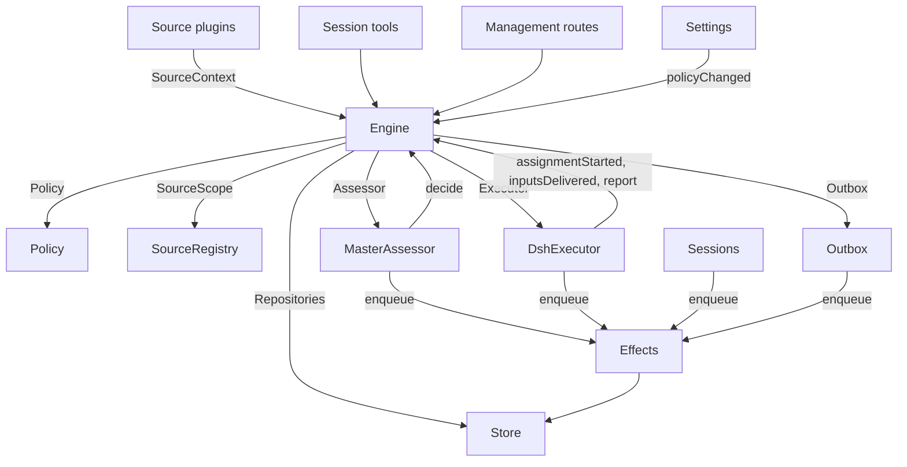

<a id="007-architecture"></a>

# 007 架构

> 原文版权：Copyright (c) 2026 DeepSeek Harness Team；MIT License。
> 原文：[007-architecture.md](https://github.com/deepseek-ai/dsh-superagent-prototype/blob/6337fc823ce20251c8de8085948165c81aaa701e/docs/007-architecture.md)  
> 固定版本：`6337fc823ce20251c8de8085948165c81aaa701e`。中文翻译，非官方；代码与配置保持原样。

这是实现层面的开发者指南。它把 [001 领域模型](001-domain.md) 到 [006 部署](006-deployment.md) 中的概念对应到类、接口和文件。先从 Runtime 和 Engine 看起，再把模块表和测试表作为代码索引使用。

<a id="core-classes-and-glue"></a>

## 核心类与衔接代码

核心类通过小型接口负责领域概念和外部边界。衔接代码把工具参数、HTTP 请求、来源载荷和 DeepSeek Harness 事件转换为对这些类的调用，再把结果转换为卡片、视图和消息。



`Runtime`（`src/app/runtime.ts`）构建应用、提供依赖，并负责启动和关闭。`Engine` 自行构建内部组件。执行器和研判器会回调 Engine，因此 Runtime 为它们提供 getter，避免必须按循环依赖的顺序构造对象。

<a id="runtime"></a>

### Runtime

`Runtime` 是组装应用的入口，不包含领域规则。它的构造函数会锁定状态目录、打开 Store 并构建各个组件。如果构造失败，就关闭 Store 并释放锁。

启动时先注册管理路由并运行 Setup。设置完成后，安装 Session 和执行器钩子，确保主 Session 存在，启动策略同步，恢复被中断的派工，再启动轮次调度和副作用处理。`ready` 表示启动完成。

关闭时会取消轮次，等待调度轮次、副作用和智能体结束，恢复进程环境，关闭 Store，并释放锁。来源插件通过窄接口 `SourceHost`，把 Runtime 作为 `orchestrator` 服务注入。

| 组件 | 模块 | 作用 |
| --- | --- | --- |
| Setup | `src/app/setup.ts` | 按工作器 Shell 实际运行 CLI 的方式探测仓库和账号，写入并应用工作器环境及命令垫片，并保留设置问题；Settings 通过它检查变更后的账号，也通过它执行重启，重启时再次运行设置流程 |
| Passes | `src/app/passes.ts` | 每两秒以及命令提出要求时运行一轮，一次只运行一轮：先处理到期副作用，再执行 `Engine.evaluateDue`；来源的触发通过它到达 Engine |
| Outbox | `src/app/outbox.ts` | 实现 Engine 的 `Outbox` 端口，也是回执的唯一写入者：`send` 在同一个事务内保存消息回执并将其 `reply` 副作用入队，副作用处理器再通过 `SourceRegistry.send` 发送；来源关闭时消息等待，对话已不存在或不再受监听时消息被丢弃 |
| Notices | `src/app/notices.ts` | 把领域事件和工作器活动转换为主 Session 消息。`eventNotice` 处理领域通知；`reportRelay` 立即转发问题，把普通进展保存在对应工单上，并转发其他报告；`followupRelay` 指明哪些工单负责某条人工后续消息。轮次进行中到达的转发消息，会通过 DeepSeek Harness 收件箱在下一步一并交付 |

<a id="engine"></a>

### Engine

`Engine`（`src/core/engine.ts`）是触发、线程、决定、工单和派工的唯一写入者。它从 `src/core/ports.ts` 接收以下端口：`Repositories`、获取当前策略的 getter、`SourceScope`、`Assessor`、`Executor` 和 `Outbox`。可选依赖为 `prepareTicket`、`now` 和 `emit`。

Engine 的所有方法都是同步的。每条命令在一个事务内修改它涉及的聚合。`evaluateDue` 对每个被修改的评估或工单分别使用一个事务。端口在事务内部将外部工作入队；适配器在提交后执行。无效请求会抛出 `UserError`。

Engine 对外提供一个入口，向内委派给五个组件。每条命令的事务都由它负责。`attach`、`evaluateDue` 和 `policyChanged` 等跨组件命令会依次调用这些组件。

每个组件都继承 `EnginePart`（`src/core/part.ts`），由后者提供选项和共享读取能力。组件之间的依赖是单向的：

| 组件 | 职责 | 依赖 |
| --- | --- | --- |
| `Intake` | 处理来源的触发：只存储一次并记录去向，记录到所属线程及其关联中，扇出给订阅工单；除非它是一条已到达某个工单的人工消息，否则在主线程上排队等待评估 | Tickets |
| `Evals` | 管理线程的评估：批处理；准入的强度、行为者和依据，以及提供这些信息的触发（`primary`）；从候选项交付时开始计算的截止时间及暂停造成的顺延；过期评估的重新入队；候选项、重放和退回；策略变更时重新入队；以及每次评估最终形成的决定：accept、stop、ignore 或 unavailable | Tickets |
| `Tickets` | 管理工单生命周期：根据接单决定创建工单及其授权、订阅和首次派工；管理工单跟随的线程及其关闭状态（`followsDone`）、附加线程和仅为获取上下文而跟随的线程、输入与备注、恢复以及恢复所拒绝的消息、重试、重启、停止和结束、取消的订阅，以及向受影响工单发送策略变更通知 | Replies |
| `Assignments` | 处理执行器及其工作器报告的事实：派工启动、输入交付成功或失败、重启造成中断，以及工作器报告和其中向人提出的问题 | Tickets、Replies |
| `Replies` | 通过 `Outbox` 向渠道写入：确认、答复、结果和待人工决定消息，每一种都遵守允许它发送的规则 | 无 |

命令使用 `stopTicket` 这样的祈使式名称；适配器报告的事实使用 `assignmentStarted` 这样的过去式名称。查询 `candidate` 使用名词。

调用者只能获得与自身角色对应的 Engine `Pick`：`EngineForSources`、`EngineForMainSession`、`EngineForPeople`、`EngineForSettings` 或 `EngineForExecutor`。

| 角色 | 方法 | 效果 |
| --- | --- | --- |
| 来源 | `receive(trigger)` | 只存储一次触发，返回 `stored`、`duplicate`，或在没有来源接收它时返回 `filtered`；将触发扇出给订阅了其线程的工单，其中人工消息会立即恢复已结束工单，除非处理已暂停；同时将触发放入主线程的评估队列，但已到达某个工单的人工消息除外，它仍归该工单负责 |
| 来源 | `bindThread(ticketId, thread, own)` | 让开放工单跟随来源的某条线程，例如拉取请求线程；若线程由工单创建，`own` 为真；已经关闭的线程再次绑定后会重新变为开放。决定工单结束的是这些线程的关闭，而非 `ready` 报告 |
| 来源 | `threadClosed(thread, outcome, at)` | 某条线程关闭后，每个跟随它的开放工单都会记录该关闭，并在所跟随线程全部处理完毕时结束（`followsDone`）：工单自己创建的线程均已关闭；若没有自己创建的线程，则它跟随的每条线程均已关闭。工单按这些关闭中最近一次的结果，以 `merged` 或 `closed` 结束。但以下情况除外：在线程关闭后恢复的工作尚未报告 `ready`；或者执行器通过确认或答复接手了一条人工后续消息，而这条消息是在最近一次非 `progress` 报告或最近一次轮次结束之后才由它负责判定的。此时，随后给出的 `dropped` 报告会让工单按线程关闭结果结束 |
| 主 Session | `candidate(triggerId)` | 读取持有该触发的评估，视角与研判器一致 |
| 主 Session | `candidateDelivered(evalId)` | 评估候选项已经到达主 Session：其截止时间从现在开始计算 |
| 主 Session | `decide(triggerId, outcome)` | 记录评估决定，或为明确请求直接记录决定。接单会原子地创建工单、授权、派工、订阅和确认消息。在卡片上忽略推断候选项时，会在给定原因之前记录 `ignoredFromCard`。只要 `followupOwners` 仍持有某条人工后续消息的责任，就只允许 stop |
| 主 Session | `attach(ticketId, triggerId, note?)` | 把触发路由到它明确指向的工单，由该工单的执行器将其作为后续消息判定；同时结束持有它的评估，该评估里的其他触发等待重新评估。已结束工单会立即依照原授权恢复，除非处理已暂停。尚由某个执行器判定的后续消息会被拒绝；将消息重新路由回曾退回它的工单，也会被拒绝 |
| 主 Session | `requestStatus(ticketId)` | 向等待中的执行器 Session 询问状态，并返回是否已发起询问 |
| 主 Session | `note(ticketId, text)` | 以文本输入的形式，向工单的执行器提供其他工作中的一个事实；此输入不授予任何权限 |
| 主 Session、执行器 | `reply(request)` | 根据消息用途，将其排入对应渠道的发送队列：`acknowledgement`、`answer`、`result` 或 `attention` |
| 人 | `stopTicket(ticketId, reason?)` | 人工停止，撤回授权 |
| 人 | `retryTicket(ticketId)` | 对 `failed` 或 `blocked` 报告后等待人工处理，或输入交付失败（`canRetry`）的工单，结束其停滞派工并启动新派工 |
| 人 | `reevaluate(triggerId)` | 将已存储触发排队，重新评估 |
| 人 | `unsubscribe(thread)` | 取消线程上的全部订阅，让原本跟随它的工单不再跟随；每个工单继续判定此前在该线程收到的后续消息 |
| 人 | `dismiss(decisionId)` | 关闭某条 `unavailable` 决定所显示的问题，并把这一操作记录在决定中 |
| 执行器 | `assignmentStarted(ticketId, assignmentId)` | 派工开始运行；交付它等待中的输入 |
| 执行器 | `inputsDelivered(ticketId, assignmentId, inputIds)` | 输入已到达该派工的执行器 Session，每条输入都等待某一步接收 |
| 执行器 | `inputsRead(ticketId, inputIds)` | 执行器 Session 已把承载这些输入的消息纳入历史（`user/message` Session 事件），模型由此获得输入；如果某一步已认领这些输入，但在此之前被取消或失败，则不算读取。只要之后出现一份报告或一次轮次结束，每条输入就算已读，重启后也一样；工单结束也不会释放对它的责任。对于早于读取记录机制交付的输入，只要其交付之后出现过报告或轮次结束，就视为已读 |
| 执行器 | `turnEnded(ticketId, assignmentId)` | 执行器 Session 的一轮结束，即使此前已经提交报告，也要等它没有后台工作运行，或正在交接给人时才算结束。先前被某一步接收的输入，此时算作已读（`inputsRead`） |
| 执行器 | `deliveryFailed(ticketId, assignmentId, error)` | 输入交付失败；工单持续显示此问题，直到某次交付成功、新派工启动或工单结束 |
| 执行器 | `report(ticketId, report)` | 记录报告及其向人提出的问题；`dropped` 会结束工单；`ready` 会完成未跟随任何线程的工单，也会让已处理完所有跟随线程的工单按这些线程的结束结果结束 |
| 执行器 | `markUnrelated(ticketId, thread, reason)` | 仅取消该工单对某条附加线程的订阅，前提是它认为该线程无关；并附上原因，退回它在该线程中负责判定的后续消息 |
| 执行器 | `followForContext(ticketId, thread)` | 让开放工单订阅一条相关线程以获取上下文：线程消息会到达工单，但不赋予后续请求的授权强度，也不会恢复工单 |
| 执行器 | `handback(ticketId, triggerId, reason)` | 记录工单退回一条此前到达它的触发，并把原因附在该触发的候选项中；如果该工单原本负责判定此触发，则等没有其他工单继续判定它时，将其排队重新评估；返回是否已入队。每个工单对每条触发只退回一次，且保留订阅 |
| 执行器 | `assignmentInterrupted(ticketId, assignmentId)` | 宿主停止时某个派工仍在运行：若在工作中途被中断，或在最新报告之后又收到输入，就像重试一样重新启动，并带上恢复说明和已交付但尚未被执行器 Session 接收的输入；若派工此后已经报告，则保留原 Session。DshExecutor 启动时（`resume`）按工单从旧到新逐个报告这些情况，并将等待中的启动重新入队 |
| Passes | `evaluateDue()` | 在处理未暂停时：为存在排队触发的线程启动评估，每条线程同时只有一个评估，其间到达的触发合并为下一批；将超过截止时间的评估中的触发重新入队，允许连续两次，第三次记录为 `unavailable`；对于暂停期间收到人工消息的已结束工单，若授权仍然有效，则恢复工单。候选项尚未到达主 Session 的评估不会过期。处理暂停期间，评估不会过期；恢复后，每个截止时间都会按暂停时长顺延 |
| Settings | `policyChanged(from, to, effects)` | 告知每个受影响的活跃工单，变更具体如何影响它（`src/policy.ts` 中的 `policyEffects`）：接单所依据的规则变更或不再适用、请求者不再能够发起工作，或不再接受主动工作；同时在新版本下重新启动进行中的评估 |

Engine 将批处理、授权、扇出、恢复和待人工决定的生命周期规则封装在内部。几个共享判定函数确保这些规则一致：

- `waitsForPerson`（`src/core/model.ts`）：最近一次派工报告了 `blocked` 或 `failed`，此后尚未收到人工消息。只要此条件成立，自动输入和失败后的启动都会保持挂起。
- `followupOwners`：仍对自身线程上收到的某条人工后续消息负责的工单。工单可以仍然活跃，也可以已经结束、没有被人工停止、正在等待恢复。退回消息会结束这项责任。
- `settled`：某个决定已经解决了该请求；stop、unavailable、routed 和 refused-stop 决定不算。
- `ticketStage`（`src/core/stage.ts`）：实现 [003 执行](003-execution.md) 中的阶段表。

工单结束时，未读后续消息会返回评估流程，除非仍有其他工单负责，或其他去向已将其解决。已确认、已答复和已退回的消息除外。对于尚未记录确认去向的旧记录，发件箱回执会提供这一事实。最终报告也覆盖派工开始时等待的消息，包括恢复该派工的消息。导致工单停止的那条消息不会自动重新评估。

发生变更后，Engine 会发出 `src/core/ports.ts` 中 `DomainEvents` 定义的某个事件：

`trigger.received`、`eval.started`、`decision.recorded`、`ticket.created`、`ticket.resumed`、`ticket.ended`、`assignment.started`、`assignment.ended`、`thread.subscribed`、`thread.unsubscribed`、`trigger.requeued` 或 `policy.changed`。

Runtime 会把 `ticket.ended`、`trigger.requeued` 和 `thread.unsubscribed` 转换成通知。已交付给工单的人工 `trigger.received` 会成为后续消息转发。工单以 merged 或 closed 结束时，`pullEndNotices` 使用稳定 ID 发送一次聊天通知。其他事件目前没有消费者。

<a id="model"></a>

### 模型

`src/core/model.ts` 保存领域类型，`src/core/stage.ts` 保存工单阶段。决定使用 `reason` 记录原因，其值是 `Reason` 列表（`src/core/reasons.ts`）：每一项都有 `code` 及其 `values`；若针对批次内某条触发，还包含其 `triggerId`。

核心中的原因代码，例如 `timeout`、`policyChanged`、`routed` 和 `startedTicket`，定义为 `REASONS`，并通过 `reasonText` 提供智能体读取的英文说明；准入或来源范围会提供自己的代码，例如 `not_a_member`；`said` 则承载研判器或人写下的文字。面板用 `reason.<code>` 呈现每个代码，来源过滤的触发也按同样方式记录来源给出的代码。

工单对每个事实只保存一次。没有 `ended` 时，工单保持开放；`ended` 记录何时、由谁、为什么以及以什么结果结束。它最近的表述就是最近一次派工报告（`latestReport`）；执行器 Session 以工单命名（`src/executor/dsh.ts` 中的 `workerSessionId`）。

其字段都有类型：`origin` 保存赋予评估批次授权强度的可准入触发，以及批次本身（`triggerId`、`triggerIds`）；`execution` 保存执行器的选择（`name`、`directory` 和 `assignment`）；`delivery` 保存最近一次输入交付失败（`error`、`at`），直到交付成功、新派工启动或工单结束；`follows` 保存来源要求工单跟随的线程，每项为 `{thread, own, closed?}`：线程由工单创建时 `own` 为真；关闭后，`closed` 包含 `at` 和 `outcome`。只有 Tickets 写入 `follows`；GitHub 来源使用 `pullsOf` 和 `pullOf`（`src/sources/github-pull.ts`）读取其中的拉取请求。

承载触发的输入会记录它是否由人编写，供 `waitsForPerson` 读取。线程还在 `context` 中列出仅为上下文而跟随该线程的订阅工单，并在 `expired` 中统计其排队触发的评估连续过期次数；Evaluation 则记录 `primary` 触发和候选项的 `delivered` 时间。

触发的去向记录它通过扇出或附加到达的工单、人工重新入队、每个退回它的工单及原因，以及每个执行器曾确认或答复它的工单。

授权的 `basis`（`MandateBasis`）记录准入如何接纳其触发。重新验证会读取接收它的 `source`、`scope` 和 `row`、名单中的 `sender`、匹配的 `rules`，以及 `via`：

| `via` | 准入依据 |
| --- | --- |
| `addressed` | 获准的发送者直接向智能体提出请求 |
| `followup` | 消息到达一条已有工单的线程 |
| `admission` | 准入表中的单元格；`observation` 标识推断候选项 |
| `bot` | 名单中的机器人产生了推断候选项 |

触发和线程的 `meta` 归来源所有。核心不解释这些数据。

<a id="policy"></a>

### 策略

`src/policy.ts` 定义设置 schema、授权规则和研判规则。每次调用 `settingsPolicy(settings, scope)` 都会返回一个新的、无状态的 `Policy`：

- `version`、`paused` 和 `evalTimeoutMs` 描述当前状态。
- `gate(trigger, thread, tickets)` 返回准入强度和依据。
- `revalidate(mandate)` 检查已有授权是否仍有效。
- `admitsInferred(rules)` 只有在自动模式下且匹配规则已启用时，才允许主动接单。

`assessmentOutcome(assessment, settings, strength)` 将模型的研判转换为 Engine 的结果。它要求对每条启用的规则都给出判断、方向已经确定、存在匹配规则，并且有意图证据。在自动模式以外，推断接单会变为“本会接单”的记录。

`policyEffects(tickets, old, now, scope)` 判断哪些开放工单受到变更影响，以及如何受到影响。`Engine.policyChanged` 只通知这些工单。`policyVersion` 对规则、接单模式和来源各自的策略部分（包括机器人名单）计算哈希。

<a id="store"></a>

### Store

`Store`（`src/app/store.ts`）负责一个 SQLite 数据库。Runtime 在打开数据库前先取得目录锁，防止第二个进程迁移或写入同一份状态。

其接口按用途分组：

- **领域存储接口：** `atomic`，以及 `triggers`、`threads`、`tickets` 和 `decisions`；后四者各自提供 `get`、`save` 和列表查询。带索引的工作集包括 `threads.active()`、`tickets.open()`、`tickets.active()` 和 `read.subscribedThreads`。
- **读取查询：** `read` 通过 `threadTriggers`、`triggerStats`、`search` 和 `droppedReplies` 等方法，为视图、工具和来源轮询提供服务。这些方法从不写入。
- **来源元数据：** `threads.describe` 和 `threads.patchMeta` 更新归来源所有的线程元数据。
- **设置：** `settings`、`saveSettings`、`blockRevision` 和 `settingsHistory`。设置和提示词使用带编号的 `Versions`（`src/app/versions.ts`）。
- **发件箱回执：** `replyStatus` 和 `receipts`，仅由 Outbox 写入。回执操作包括 `get`、`waiting`、`behind`、`add`、`settle` 和 `withdraw`。`behind` 检查同一工单发往同一对话的较早消息是否仍在等待，且失败次数少于三次。撤回的消息会以 `channelGone` 或 `channelIgnored` 结算。读取查询通过 `failingReplies`、`droppedReplies` 和 `droppedSince` 暴露失败和丢弃的回复。
- **带类型的键值记录：** 使用 `KV` 中的条目调用 `get`、`set`、`delete` 和 `keys`。

`afterCommit` 只在事务提交后执行动作，回滚后绝不执行。Runtime 按记录当前存储的结构读取；schema 11 迁移会在启动时转换受支持的旧记录。

<a id="effects"></a>

### Effects

`Effects`（`src/app/effects.ts`）是持久化副作用队列。命令在事务内部调用 `enqueue(kind, key, payload)`，只有提交后才开始执行。

每个 kind/key 组合对应一行。重复入队一个仍在等待的 key，会替换其载荷并使其立即到期，但不改变队列顺序。`handle(kind, run, options)` 为每种 kind 注册一个处理器。到期记录按从旧到新的顺序处理，并受并发上限约束。

失败后按指数退避重试。抛出 `Later` 会推迟工作，但不计为失败，例如没有可用工作器槽位时。`start` 在设置完成后启动处理，`drain` 在关闭期间停止处理并保留待处理记录，`pending`/`idle` 暴露队列状态。

| 类型 | 处理器 | 作用 | 同时执行数 | 重试 |
| --- | --- | --- | --- | --- |
| `assessment` | MasterAssessor | 将评估候选卡片引导到主 Session 的轮次中，再告知 Engine 已交付，从而启动评估截止时间计时 | 4，暂停时为 0 | 2 秒起，每次翻倍，最多 60 秒 |
| `launch` | DshExecutor | 启动待处理派工：准备命令、执行器 Session、派工消息 | 可用工作器槽位数，暂停时为 0 | 模型提供方或网络的暂时故障会在 5 秒后重试，间隔翻倍至 300 秒，共重试三次；其他任何故障，以及准备命令失败，都会让工单失败。因暂停或工作器槽位已满而挂起的启动，5 秒后再试 |
| `delivery` | DshExecutor | 按顺序将工单等待中的输入交给运行中的派工 | 4，暂停时为 0 | 2 秒起，每次翻倍，最多 60 秒；等待工作器槽位时，2 秒后再试 |
| `relay` | Sessions | 将工作器的报告或问题，或人工后续消息，引导到主 Session 的轮次中 | 1，按队列顺序 | 2 秒起，每次翻倍，最多 60 秒 |
| `notice` | Sessions | 向主 Session 注入通知，但不唤醒它 | 1，按队列顺序 | 2 秒起，每次翻倍，最多 60 秒 |
| `reply` | Outbox | 通过来源为渠道发送消息；先等待同一工单发往同一对话且失败未满三次的较早消息；撤回消息会取消发送 | 1，暂停时为 0 | 5 秒起，每次翻倍，最多 300 秒；来源关闭或前面还有消息时，5 秒后再试 |

每种 kind 都有一个以自身名称标识的健康状态条目。该类型某个副作用连续失败三次后，就会报告错误；`delivery` 除外，它的失败直接显示在对应工单上。转发消息保持顺序，通知也一样；其中某条失败会阻挡同类型的后续条目。

<a id="sources"></a>

### 来源

来源通过 `src/sources/kind.ts` 中定义的 `SourceKind` 扩展宿主。来源类型声明自身标识、标题、描述、配置 `schema` 和 `fields`、派生 `facts`，以及 `health` 条目。可选行为包括 `scope`、`channel`（`allowed`、`send`、`link`）、`threadContext`、`find`、`policy`、`environment` 和 `refreshLabels`。

`SourceRegistry`（`registry.ts`）负责已注册类型和已存储实例，并实现 Engine 的 `SourceScope`。注册时会在 `HealthBoard` 上认领健康状态条目；重复认领和保留的 `sync:` 名称都会被拒绝。SourceContext 只能写入该次注册认领的条目，因此注销后再上报不会产生效果。

Registry 的配置方法包括 `kind`、`instances`、`instance`、`validate`、`validatePolicy`、`policyPart`、`channelAllowed`、`declarations`、`environments`、`find` 和 `scope`。`find` 会查询每种支持搜索的来源类型。

通用代码通过 Registry 访问来源行为。`send(message, commands)` 调用对应类型的渠道，返回 `sent`、`gone`，或在该类型尚未安装时返回 `waiting`。`link` 解析渠道链接。`threadContext` 将来源类型的读取器与其配置配对；若该类型没有读取器，就不返回内容。已存储配置无效时，会禁用该实例。

插件获得的是 `SourceHost`：Registry 和 `context(kind)`。来源类型自身使用更窄的 `SourceContext`，由 `src/app/source-context.ts` 中的 `sourceContextOf` 构建。

这个上下文提供部署信息和命令、设置就绪状态（`ready`、`configured`、`problem`）、配置、`receive`、`atomic` 和带类型的 `state`。它还暴露线程读取与元数据写入、工单读取与绑定/关闭命令、触发读取、经由 Outbox 的 `notify`，以及针对已声明健康状态条目的 `report`。

<a id="dshexecutor"></a>

### DshExecutor

`DshExecutor`（`src/executor/dsh.ts`）为每个工单提供一个 Session 和一个目录。`start` 和 `deliver` 将 `launch` 和 `delivery` 副作用入队。`stop` 通过 `Store.afterCommit` 取消轮次，因此已回滚的结束操作不会停止工作器。

`prepare(ticket, outcome)` 提供 Engine 的 `prepareTicket` 钩子：短名称、目录和 `ticketExecution` 派工文本。`workerSessionId(ticket.id)` 派生出 Session ID。

`WorkerSlots` 会在启动之前，或在某次输入交付即将唤醒空闲工作器之前，预留容量。人工消息可以使用超出 `maxWorkers` 的一个额外槽位，唤醒的优先级高于新启动。`activeCount` 为面板提供负载数据。

模型提供方和网络的暂时故障会获得三次重试。启动使用副作用退避；失败的轮次会在 15、30 和 60 秒后收到继续执行消息。`inputMessage` 根据工单当前状态渲染每条输入，`mandateInstructions` 为推断工作补充匹配规则的限制。

`install` 订阅 Session 事件，`dispose` 取消订阅。轮次结束通常会报告 waiting，但已就绪或需要人工操作时除外。错误会报告 failed。启动时，`resume` 通过 `assignmentInterrupted` 报告被中断的派工，并按工单从旧到新的顺序，将不在等待人工处理的待启动任务重新入队。

<a id="masterassessor"></a>

### MasterAssessor

`MasterAssessor`（`src/app/assessment.ts`）让主 Session 研判主动候选项。`request` 将 assessment 副作用入队；对应评估结束时，`release` 丢弃缓存状态。

其 `context`、`read` 和 `decide` 方法分别服务于 `orchestrator_eval`、`orchestrator_eval_read` 和 `orchestrator_eval_decide`。它们通过 `SourceRegistry.threadContext` 提供有界的线程上下文、仓库上下文，以及决定提交能力。没有上下文读取器的来源类型只提供触发和批次。

`assessmentOutcome` 将模型回答转换为 `Engine.decide` 所需的格式。Evals 会再次根据当前策略检查推断接单。

<a id="settings"></a>

### Settings

`Settings`（`src/app/settings.ts`）读取和写入带修订号的设置块。`current` 和 `view` 负责读取；`save(block, value, revision, origin)` 验证保存操作；`pause(paused, origin)` 修改独立的 `paused` 设置。

每次保存都声明来源：`panel`、`tool` 或 `sync`。只有 `panel` 可以修改执行环境，或 `SETUP_FIELDS`（`src/deployment.ts`）中列出的字段。

策略版本变更时，会计算 `policyEffects`，记录通知了哪些工单，并调用 `Engine.policyChanged`。`syncable` 和 `sync(id)` 刷新来源的策略部分。`refreshLabels(id)` 刷新显示名称。

<a id="prompts"></a>

### Prompts

`Prompts`（`src/app/prompts.ts`）将配置存储为 `Versions`。`current`、`version` 和 `history` 负责读取；`validate`、`preview` 和 `save(value, baseRevision, source)` 检查并保存配置。`compose` 和 `skills` 构建 Session 文本。

`builtInParts` 列出覆盖项的键、角色、默认文本和必需的模板占位符。每个覆盖项保存团队编写的 `text` 和一个 `base`：即其原始默认文本的 `builtInBase` 键。保存时会在 `KV.prompts.builtIn` 中保留该默认文本。此后，`defaultChanged` 会报告发生变化的默认项、可获得时的旧文本，以及已移除的部分。

验证时，若省略 base，就从已保存的覆盖项继承；对于已保存数据中已有但现已移除的部分，会将其剔除；空白文本和其他未知键则被拒绝。这使保存工具能够将读出的配置原样传回。`environmentSection` 和 `policySection` 仅使用对象自身的键，对模板值执行一次替换。没有覆盖项的配置使用默认值。

<a id="sessions"></a>

### Sessions

`Sessions`（`src/app/sessions.ts`）管理两种角色的 DeepSeek Harness Session。`ensure` 使用对应角色的模型创建 Session。`install` 跟踪智能体事件，并为受管理 Session 注册提示词、技能和工具。

`prompt` 对每个请求 ID 只交付一次。`relay` 和 `notify` 将主 Session 消息入队，分别由 `relay` 和 `notice` 副作用处理。`src/app/notices.ts` 定义消息内容；`delivery` 检查消息是否到达。

每次模型请求都会将 Session 绑定到当前提示词修订版本。用过的修订版本会持久化保存：`promptVersion` 标识当前生效版本，`mayRead` 限制工作器可查看的版本。每个智能体各有一张 map，用于跟踪注册项。

`status` 和 `promptVersion` 为提示词页面提供数据。保存经由 `Prompts.save`，并通知主 Session。`modelRetry` 暴露模型预算重试状态。

<a id="glue"></a>

### 衔接代码

| 衔接代码 | 转换职责 |
| --- | --- |
| `src/app/runtime.ts` | 组装入口：按照各部分使用的接口构建它们，注册路由和来源宿主，并启动、停止 dsh-superagent |
| `src/app/notices.ts` | 将领域事件和工作器报告转换为主 Session 的通知与转发消息 |
| `src/app/tools/main.ts`、`src/app/tools/executor.ts` | 将主 Session 和执行器 Session 的工具参数转换为核心类调用，并将结果转换成卡片 |
| `src/app/http.ts`、`src/app/views/`、`src/app/api.ts` | 将 HTTP 请求转换为调用，将 Store 读取结果转换为面板视图；`api.ts` 为面板的每条路由定义类型 |
| `src/app/resources.ts`、`src/app/links.ts`、`src/app/cards.ts` | 将资源名称转换为读取操作、来源消息转换为链接、记录转换为供模型使用的紧凑卡片 |
| `src/sources/github*.ts`、`src/sources/feishu*.ts`、`src/sources/poll.ts` | 将 GitHub 和飞书载荷转换为触发和线程事实，将消息转换为 CLI 调用 |
| `src/deployment.ts`、`src/setup.ts`、`src/infra/` | 负责设置探测与问题、CLI 传输、智能体进程环境 |

<a id="dependency-rules"></a>

## 依赖规则

- **显式而窄的依赖。** 每个类都接收明确列出所用能力的接口，多数是其他类的 `Pick` 类型：核心类使用 `ExecutorHost`、`AssessorHost`、`SessionsHost`、`SettingsHost`、`SetupHost`、`PassesHost` 和 `OutboxHost`；衔接代码使用 `HttpHost`、`MainToolsHost`、`ExecutorToolsHost`、`ResourceHost`、`LinkHost` 和 `SourceContextDeps`；Engine 则按调用者角色提供相应 `Pick`。Runtime 只有通过这样的接口才会传递自身。来源插件注入 `orchestrator` 服务，其类型将它声明为 `SourceHost`：Registry 和 `context(kind)`；来源类型的代码只能看到自己的 `SourceContext`。
- **允许谁导入谁。** `src/core` 除 Node 的哈希功能之外，不导入自身以外的任何模块，也不做 I/O。`src/sources` 不导入 `src/app` 中的任何内容。面板仅从宿主侧导入类型，以及 `src/admission.ts`、`src/limits.ts`、`src/setup.ts`、`src/navigation.ts`、`src/sources/host.ts`、`src/core/errors.ts`、`src/core/reasons.ts` 的普通值和 `src/app/api.ts` 的筛选列表。
- **每种状态只有一个写入者。** 每一类状态由一个写入者负责，其他部分只能读取它，或向该写入者提出请求。

  | 状态 | 写入者 |
  | --- | --- |
  | 触发、线程、决定、工单、派工 | Engine |
  | 来源的读取位置，以及保存在其线程上的元数据（`label`、`url`、`facts` 和它自己的键） | 该来源，通过 `SourceContext` 写入 |
  | 设置及其历史 | Settings |
  | 提示词版本 | Prompts |
  | 副作用记录行 | Effects |
  | 发件箱回执 | Outbox：Engine 的消息和来源的 `notify` 都经过其 `send`，再由其 `reply` 副作用标记回执 |
  | 健康状态条目 | 在 `HealthBoard`（`src/infra/health.ts`）上认领该条目的组件；HealthBoard 拒绝第二次认领：`runtime` 由 Runtime 负责，Passes 经由它上报；`evals` 由 Runtime 在每轮结束后上报；`models` 由 Sessions 负责；各副作用类型由 Effects 负责；`worker` 由 DshExecutor 负责；来源类型声明的条目由 SourceRegistry 为该类型的来源负责；`sync:<id>` 由 Settings 负责 |

  来源只能通过 `SourceContext.tickets.bindThread` 和 `threadClosed` 修改工单，这两者都会调用 Engine。
- **请求与事实。** 请求某项操作的方法，以祈使动词加对象命名，例如 `stopTicket` 或 `bindThread`，而且可以被拒绝；记录适配器已完成动作的方法使用过去式，例如 `assignmentStarted` 或 `deliveryFailed`。每个宿主都以自己需要的角色类型接收 Engine。
- **字段有类型，来源数据归来源。** 代码读取工单和授权的带类型字段。来源不在工单上保留自己的数据：工单跟随了它的哪些线程，由工单的 `follows` 表示；来源保存的触发或线程信息则放在相应的 `meta` 中。
- **固定的拒绝代码。** 人或智能体可能引发的拒绝，使用 `src/core/errors.ts` 中 `USER_ERRORS` 定义的 `UserError(code, values)`。管理 API 对 `missing` 代码返回 404，对其余代码返回 400；面板用自身语言显示每个代码。设置问题使用 `SetupError` 代码（`src/setup.ts`）和固定健康状态文本 `HealthCode`（`src/sources/host.ts`），采用相同的本地化方式。
<a id="source-specific-dependencies"></a>

### 来源特定依赖

一些通用模块仍直接依赖 GitHub 或飞书：

- Outbox 应用飞书聊天字数限制。
- `src/app/links.ts` 解析飞书消息链接和 `repliedTo`。它与 Runtime 都通过 `feishuSettings` 读取设置。
- `src/app/resources.ts` 读取 `feishu/` 和 `github/` 原始资源；`src/app/cards.ts` 用 `pullOf` 生成工单卡片。
- Runtime 为已合并或已关闭的工单发送 `pullEndNotices`。
- 执行器工具使用 `readPull` 和 `claimPull` 绑定报告中的拉取请求，并使用 Runtime 暴露的 GitHub 上下文。
- MasterAssessor 使用 `readRepositoryPath` 读取仓库文件。
- Sessions 和 Prompts 只为 GitHub 和飞书注册内置技能。迁移会转换它们的 schema-10 记录。
- Setup 只探测 GitHub 和飞书账号字段（`SETUP_FIELDS`）。只有这些来源会通过 `SourceContext.problem` 接收账号设置问题。


<a id="modules"></a>

## 模块

| 路径 | 职责 |
| --- | --- |
| `src/index.ts` | 主插件入口：读取机器设置、启动 Runtime，并为其提供来源账号保存时使用的重启能力 |
| `src/deployment.ts` | 插件 `Config` 和 `Machine`；`resolveDeployment` 和 `resolveFeishuBot` 从来源设置中读取仓库和账号，每次 CLI 都按执行器 Shell 的运行方式执行；`SETUP_FIELDS` 列出设置流程读取的来源字段。代码不硬编码任何人、账号或组织 |
| `src/setup.ts` | 设置问题：`SetupError`，包含代码、修复位置，以及日志、主 Session 和面板共用的英文文本 |
| `src/policy.ts` | 策略：按块组织的设置 schema、策略版本、准入和授权重新验证 |
| `src/admission.ts` | 准入表的值、每个单元格的选项和默认值，与面板共享 |
| `src/limits.ts` | 人可设置值的限制，设置 schema 会校验，面板字段会提供这些约束 |
| `src/kv.ts` | `KV`：每个 `kv` 记录族的键、值类型和所有者，以及 Store 和 `SourceContext.state` 接收的 `Key` 与 `Family` 类型 |
| `src/navigation.ts` | 宿主目录列出某个 DeepSeek Harness Session 后，从面板打开它 |
| `src/core/model.ts` | 领域类型，包括带类型的工单和 `MandateBasis`，以及 `threadKey`、`ticketOutcome`、`reached`、`followupOwners`、`settled`、`waitsForPerson`、`liveTicket`、`runningAssignment`、`latestAssignment` 和 `latestReport` |
| `src/core/ports.ts` | 端口：`Repositories`、`Policy`、`SourceScope`、`Assessor`、`Executor`、`Outbox`，以及领域事件 |
| `src/core/engine.ts` | Engine，即核心入口，以及角色接口 `EngineForSources`、`EngineForMainSession`、`EngineForPeople`、`EngineForSettings` 和 `EngineForExecutor` |
| `src/core/part.ts` | Engine 各组件的基类 `EnginePart`，以及 `EngineOptions` |
| `src/core/intake.ts` | `Intake`：将来源触发交给相应工单；除非人工消息已到达某个工单，否则也交给评估 |
| `src/core/evals.ts` | `Evals`：线程的评估及其决定 |
| `src/core/tickets.ts` | `Tickets`：工单生命周期、工单跟随的线程、订阅和输入 |
| `src/core/assignments.ts` | `Assignments`：执行器的事实及其工作器的报告 |
| `src/core/replies.ts` | `Replies`：Engine 的渠道写入 |
| `src/core/stage.ts` | `ticketStage` 和 `canRetry`：[003 执行](003-execution.md) 中的工单阶段 |
| `src/core/errors.ts` | `UserError` 和 `USER_ERRORS` |
| `src/core/reasons.ts` | `Reason`、`REASONS` 和 `reasonText`：用代码说明核心为何记录某个决定或将某条触发搁置 |
| `src/core/ids.ts` | `key`：根据输入派生 ID，相同输入得到相同 ID |
| `src/core/memory.ts` | `MemoryRepositories`：Store 存储接口的内存实现，保持 Store 的顺序和嵌套回滚行为，用于领域测试 |
| `src/core/index.ts` | 核心导出项 |
| `src/app/runtime.ts` | Runtime，组装入口，负责启动与停止 |
| `src/app/setup.ts` | Setup，以及 `setupChanged`，用于判断一次保存是否改变了设置流程读取的字段 |
| `src/app/passes.ts` | Passes，轮次调度器 |
| `src/app/outbox.ts` | Outbox：Engine 的 `Outbox` 端口、回执，以及负责发送的 `reply` 副作用 |
| `src/app/notices.ts` | 主 Session 的通知与转发：`eventNotice`、`reportRelay`、`resultRelay` 和 `followupRelay` |
| `src/app/store.ts` | Store，以及表示发件箱消息的 `Receipt` |
| `src/app/store-read.ts` | `storeReads`：供视图、工具和来源轮询使用的 Store 读取查询，从不写入 |
| `src/app/migration.ts` | schema 11 迁移：从 schema 10 一步迁移，把每条已存储记录写成当前结构 |
| `src/app/effects.ts` | Effects |
| `src/app/versions.ts` | `Versions`：用编号快照保存记录，并指向当前快照，供设置和提示词使用 |
| `src/app/cache.ts` | `TextCache`：在大小限制内将文本保存在内存中，优先丢弃最久未使用的内容 |
| `src/app/settings.ts` | Settings |
| `src/app/settings-history.ts` | `policyHistory`：每次已保存的设置修订，以及它相对于上一修订的变更 |
| `src/app/prompts.ts` | Prompts、团队可以覆盖的内置部分 `builtInParts`，以及角色提示词各节顺序 `promptParts` |
| `src/app/context.ts` | 从 `prompts/` 读取的内置提示词文本，以及 Sessions 读取的会话记录条目 |
| `src/app/skill-files.ts` | 随包提供的文本：`promptFile` 把文件中每行一句的文本合并为段落，以及随包提供的技能 |
| `src/app/sessions.ts` | Sessions |
| `src/app/delivery.ts` | `AgentDelivery`：针对每个请求 ID，只向 DeepSeek Harness 智能体交付一次消息，Session 恢复后也一样 |
| `src/app/retry-health.ts` | `RetryHealth`：记录哪些 Session 正在等待模型预算重试，供 `models` 健康状态条目使用 |
| `src/app/role-models.ts` | 解析评估与执行器模型，并用角色对应的模型初始化新 Session |
| `src/app/assessment.ts` | MasterAssessor、研判 schema，以及 `orchestrator_eval` 返回的上下文窗口 |
| `src/app/execution-environment.ts` | 执行环境：变量、某个工单的变量值、目录根路径和提示词小节的文本行，由 `src/app/prompts.ts` 填入模板 |
| `src/app/source-context.ts` | `sourceContextOf`：每种来源类型的 `SourceContext` |
| `src/app/links.ts` | `sourceLink`、触发消息对应的页面，以及 `candidateCard` |
| `src/app/cards.ts` | 供模型使用的触发、工单、线程和决定紧凑卡片；封闭的工单卡片状态集合 `TICKET_STATES`；以及 `textPage` |
| `src/app/resources.ts` | `RESOURCES` 和 `readResource`：各角色的 `orchestrator_read` 可以读取的内容 |
| `src/app/tools/tool.ts` | `Tool` 类型、`readTool`、两种角色的 `orchestrator_read`，以及 `AcknowledgementSchema` |
| `src/app/tools/main.ts` | 主 Session 的工具 |
| `src/app/tools/executor.ts` | 执行器 Session 的工具 |
| `src/app/http.ts` | `/orchestrator/api` 路由：同源检查、请求限制，以及每类失败对应的状态码 |
| `src/app/api.ts` | `Api`，包含每条路由的参数、查询、请求体和响应，以及列表筛选项；只导入类型，因此面板可以将其打包 |
| `src/app/views/text.ts` | 视图文本的两种形式：`preview`，单行纯文本；以及不含 HTML 的 `markdown`；还有 `plain` 和 `readable` |
| `src/app/views/records.ts` | 各视图共用的行：触发、工单、线程、决定和渠道链接；以及 `ownersOf`，按一次请求的读取视图确定后续消息的责任工单 |
| `src/app/views/tickets.ts` | 按阶段组织的工单列表、工单页面、授权依据事实，以及执行器负载 |
| `src/app/views/threads.ts` | 线程列表、线程时间线、搜索和决定列表 |
| `src/app/views/sources.ts` | 来源状态：每个来源实例的状态、过去一天的计数，以及当天过滤和丢弃的内容 |
| `src/app/views/settings.ts` | 设置页面视图：每个设置块及其修订号、每个来源的设置和所属类型的表单，以及执行环境 |
| `src/app/views/overview.ts` | 总览：需要人工处理的工单、问题、过去一天的流程统计，以及执行器负载 |
| `src/executor/dsh.ts` | DshExecutor、`WorkerSlots`、`ticketExecution`、`inputMessage` 和 `mandateInstructions` |
| `src/executor/background.ts` | 工作器在 DeepSeek Harness 中的后台工作、其 Session 拥有的 Shell 作业（`ctx.jobs`）及子智能体（`ctx.subagents`）：`runningJobs`、`untilQuiet`、`killJobs`、`collectJobs`、`stopSubagents`、`stopBackground`、`until`，以及 `cancelled`，后者记录因停止子智能体而取消了轮次的工作器 |
| `src/infra/commands.ts` | CLI 传输 `Commands`：`run`；限制在已配置仓库内并进行验证的 `api` 和 `pages`；以机器人身份运行的 `lark`；以及 `git`。`CliError` 携带命令输出中报告的代码，例如 GitHub HTTP 状态码；没有任何输出的命令会根据退出方式报告失败，绝不会带上命令参数；`validItems` 跳过列表中格式错误的条目并计数 |
| `src/infra/environment.ts` | 智能体进程环境：命令垫片、git 配置和凭据助手、`runAsWorker`，以及对环境和工单目录的检查 |
| `src/infra/paths.ts` | 包根目录，即随包文件所在位置 |
| `src/infra/text.ts` | 字数统计与聊天消息限制、`fill` 和 `sameName` |
| `src/infra/health.ts` | `HealthBoard`，管理各部分的健康状态条目，每项都由唯一写入者认领 |
| `src/sources/kind.ts` | `SourceKind` 协议 |
| `src/sources/registry.ts` | `SourceRegistry` |
| `src/sources/host.ts` | `SourceHost`、`SourceContext`、`Health`、`health` 和固定健康状态文本 |
| `src/sources/poll.ts` | GitHub 与飞书轮询共用的内容：`POLL_HORIZON_MS`、`polled`、`cursorAt` 和 `pollThreads`；后者将失败以 `pollError` 保存在相应线程上 |
| `src/sources/github.ts` | GitHub 类型和插件入口，导出为 `./github-watch`：一轮轮询处理通知、开放工单的拉取请求及其 CI，以及已订阅线程 |
| `src/sources/github-trigger.ts` | 将 GitHub 评论、评审、Issue 正文和 CI 变更转换为触发，以及 GitHub 地址 |
| `src/sources/github-pull.ts` | 拉取请求规则：工单跟随哪些拉取请求（`claimPull`、`observePull`）、向 Engine 报告哪些关闭，以及 `pullEndNotices`，即工单以 merged 或 closed 结束时的聊天通知 |
| `src/sources/github-channel.ts` | GitHub 渠道：评论和评审线程回复，返回 `sent` 或 `gone` |
| `src/sources/github-read.ts` | CI 快照、仓库读取、`github/` 资源，以及 `githubThreadContext`：按页读取 Issue 或拉取请求对话 |
| `src/sources/feishu.ts` | 飞书类型和插件入口，导出为 `./feishu-watch` |
| `src/sources/feishu-trigger.ts` | 把飞书消息转换为触发，对实时事件、历史页面和话题页面采用同一套规则 |
| `src/sources/feishu-loops.ts` | 飞书循环：事件消费者、历史恢复、聊天名称，以及已订阅话题的轮询 |
| `src/sources/feishu-channel.ts` | 飞书渠道：话题回复，返回 `sent` 或 `gone` |
| `src/sources/feishu-read.ts` | `feishu/` 读取：触发对应消息、根消息、父消息和话题；以及 `feishuThreadContext`，将这些内容连同图片提供给研判 |
| `src/sources/admission-context.ts` | 研判开始时的有界窗口：通过来源类型读取触发所在线程的前几页，以及触发附近的消息 |
| `src/sources/feishu-image.ts` | 将飞书消息图片读取为附件，提供给执行研判的 Session |
| `src/client/index.tsx` | 客户端插件入口：侧边栏入口、主面板，以及 DeepSeek Harness 插件管理器中的页面 |
| `src/client/app.tsx` | 面板：页头、搜索、术语表、标签页，以及当前路由对应的页面 |
| `src/client/provider.tsx` | 每个页面从宿主读取的内容：文案、调用、导航、通知、状态轮询，以及 `restart`；dsh-superagent 重启期间，`restart` 会快速读取状态 |
| `src/client/api.ts` | 管理 API 的调用与轮询，类型由 `src/app/api.ts` 定义；以及评估状态的决定筛选项 |
| `src/client/route.ts` | 标签页、设置分组、由 `parseRoute` 读取的带类型路由，以及记住上次打开设置分组的路由记忆 |
| `src/client/overview.tsx` | 总览 |
| `src/client/source.tsx`、`trigger.tsx`、`eval.tsx`、`execution.tsx` | 每个阶段一个文件：阶段状态，以及该阶段具有设置项时的设置 |
| `src/client/thread.tsx`、`ticket.tsx` | 记录页面：线程及其时间线；工单及其授权、输入和派工 |
| `src/client/settings.tsx` | 设置标签页：分组导航和当前显示的分组 |
| `src/client/settings-kit.tsx` | 设置块的构建单元：阶段分组共用的设置、`useBlockDraft`、包括来源类型字段在内的各类字段，以及保存历史 |
| `src/client/prompts.tsx` | 提示词设置：页面拥有读出的视图，编辑器拥有草稿；编辑、完整提示词和历史标签页据此渲染；内置部分的编辑器显示已变化的默认文本，并可保留或移除覆盖项 |
| `src/client/prompt-config.ts` | 按小节组织的提示词配置，包括团队小节、技能名称、内置部分（`part/<key>`，配合 `withOverride`）和提示词视图提供的小节标题，以及完整提示词的行级差异，均为纯函数 |
| `src/client/deployment.tsx` | 部署设置，也显示在 DeepSeek Harness 插件管理器中 |
| `src/client/draft.tsx` | 设置草稿：`draftReducer`、草稿状态及其与更新的已保存修订的合并，`saveBarText`、保存栏提示行，以及保存栏 |
| `src/client/controls.tsx` | DeepSeek Harness 控件的本地副本，遵循其标记结构、键盘行为和设计 token，因为包不会导入 `@deepseek-ai/dsh-client-ui-primitives`；这些控件不读取上下文 |
| `src/client/widgets.tsx` | 页面共用的小组件，读取面板上下文：区段、页头、加载状态、时间、链接、需要确认的操作、设置检查和 Markdown |
| `src/client/rows.tsx` | 页面共用的行：工单、线程和决定行、线程标签，以及连续自动消息的折叠 |
| `src/client/markdown.ts` | 将报告和问题使用的 Markdown 子集，以及消息中的裸地址，表示为块与行内部分 |
| `src/client/text.ts` | 按键组织的文案，以及领域值、原因、发送者和时间的表述 |
| `src/client/marks.ts` | 视图所分类状态的标记：工单或线程阶段、来源状态、决定结果，每种都有圆点、图标、色调和标签 |
| `src/client/locales.ts` | 两种语言的全部文案，以及 [001 领域模型](001-domain.md) 的术语表 |
| `src/client/client.css`、`css.d.ts` | 面板样式表，以文本加载 |

`src/sources/github.ts` 和 `src/sources/feishu.ts` 同时也是两个来源插件的入口，由 `tsdown.config.ts` 构建，并在 `package.json` 中导出为 `./github-watch` 和 `./feishu-watch`。包的 `cordis.patch.yml` 会插入三个插件，飞书默认禁用。

<a id="tests"></a>

## 测试

| 测试 | 覆盖范围 |
| --- | --- |
| `tests/core-engine.spec.ts` | 基于内存存储接口验证领域规则：接收、评估、扇出、恢复与停止、中断的派工、暂停、策略变更、报告与结果、附加、回复、交付失败和关闭问题 |
| `tests/stage.spec.ts` | 逐行验证工单阶段表 |
| `tests/policy.spec.ts` | 来源范围、准入、准入表、授权重新验证、策略版本、设置迁移和研判结果 |
| `tests/registry.spec.ts` | `SourceRegistry`：实例、验证、策略部分、渠道和线程上下文 |
| `tests/sources.spec.ts` | 基于 `SourceContext` 的飞书与 GitHub 来源：转换、轮询与读取位置、拉取请求规则、健康状态 |
| `tests/commands.spec.ts` | 以部署账号运行的 CLI 调用、渠道响应，以及限定仓库范围的 GitHub 调用 |
| `tests/feishu-read.spec.ts`、`tests/github-read.spec.ts` | 飞书和 GitHub 读取 |
| `tests/admission-context.spec.ts`、`tests/feishu-image.spec.ts` | 研判的线程窗口，以及飞书图片读取 |
| `tests/assessment.spec.ts` | MasterAssessor 为每次评估保留哪些状态，以及何时释放 |
| `tests/background.spec.ts` | 等待工作器 Shell 作业与子智能体：结束事件唤醒工作器，以及宿主停止的情况 |
| `tests/bundle-patch.spec.ts` | 按 DeepSeek Harness 的读取方式读取包的补丁，以及其中定义的执行器 Session 智能体预设 |
| `tests/effects.spec.ts` | 副作用队列：合并、限制、退避重试、健康状态和关闭 |
| `tests/passes.spec.ts` | Passes：每次只运行一轮，一轮期间收到的执行请求会合并为后续一轮，以及轮次失败时报告的运行时健康状态 |
| `tests/outbox.spec.ts` | 运行中 Runtime 上的 Outbox：处理暂停或来源未安装时，消息保持等待 |
| `tests/cache.spec.ts` | `TextCache` |
| `tests/queue.spec.ts` | Runtime 经副作用队列开展的工作，以及旧版本保存的内容 |
| `tests/followups.spec.ts` | 工单线程上的人工后续消息：向主 Session 发出的通知、处理它的工具、突发消息的成本；工作器的退回与上下文跟随，以及主 Session 的备注 |
| `tests/health.spec.ts` | 每部分一个健康状态条目，各自在下一次成功时清除 |
| `tests/delivery.spec.ts` | `AgentDelivery` |
| `tests/retry-health.spec.ts`、`tests/role-models.spec.ts` | 模型预算重试，以及两种角色的模型 |
| `tests/runtime.spec.ts` | 通过工具和 HTTP，在模拟 DeepSeek Harness 宿主上验证整个应用 |
| `tests/tools.spec.ts` | Session 工具：各角色的 `orchestrator_read` 可读取什么，以及其他主 Session 工具的数据结构与检查 |
| `tests/runtime-concurrency.spec.ts` | 重叠执行的工作：轮次期间到达的触发、输入交付和启动期间发生变化的工单 |
| `tests/http.spec.ts` | 同源与环回地址检查、各类失败状态、请求体限制、路径参数和查询参数 |
| `tests/settings.spec.ts` | 与模型或账号检查竞争的设置保存、被更新保存赶超的策略同步，以及暂停、同步和设置块的拒绝情况 |
| `tests/views.spec.ts` | 管理视图从 Store 派生出的内容，例如丢弃消息属于哪条线程 |
| `tests/timeline.spec.ts` | 按时间再按 ID 排序的线程分页与触发邻近消息，以及所有已接收触发使用统一的时间表示 |
| `tests/migration.spec.ts` | schema 11 迁移：每条已存储记录都成为当前结构，并拒绝更老的 schema |
| `tests/store.spec.ts` | SQLite 与内存实现中的存储接口及其工作集、kv 区域、仅在 `src/kv.ts` 和迁移代码中拼写 `KV` 各键、设置历史与查询 |
| `tests/prompts.spec.ts` | 提示词验证、组装和版本 |
| `tests/cards.spec.ts` | 逐文件检查内置文本必须说明的规则 |
| `tests/model-surface.spec.ts` | 模型读取的全部内容：工具、提示词、技能和输入；对照工具 schema、执行环境和术语表检查，并限定在各角色的大小预算内 |
| `tests/deployment.spec.ts`、`tests/environment.spec.ts`、`tests/index.spec.ts` | 插件配置与设置、智能体进程环境、插件入口 |
| `tests/service-script.spec.ts` | 使用假的 `ps`、`tmux` 和 `dsh` 验证 `scripts/dsh-superagent` |
| `tests/client.spec.tsx`、`tests/navigation.spec.ts`、`tests/controls.spec.tsx` | 客户端插件注册与轮询、Session 导航与路由记忆、本地控件，以及面板无循环的导入关系 |
| `tests/panel-overview.spec.tsx`、`panel-source.spec.tsx`、`panel-trigger.spec.tsx`、`panel-eval.spec.tsx`、`panel-execution.spec.tsx` | 使用按路由返回结果的模拟管理 API 验证面板各页面 |
| `tests/panel-settings.spec.tsx`、`panel-prompts.spec.tsx`、`panel-deployment.spec.tsx`、`panel-panel.spec.tsx` | 设置分组、草稿与历史、提示词、部署页面，以及面板搜索、术语表和路由记忆 |
| `tests/draft.spec.ts`、`tests/prompt-config.spec.ts`、`tests/markdown.spec.ts`、`tests/marks.spec.ts` | 草稿状态、合并与保存栏提示行；按小节组织的提示词配置与行级差异；Markdown 子集及其链接；视图所分类的每种状态的标记 |
| `tests/locales.spec.ts`、`tests/styles.spec.ts` | 两种语言的文案、样式表 |
| `tests/class-docs.spec.ts` | `src` 中的每个类前面都有 JSDoc 块 |
| `tests/docs.spec.ts` | 编号文档只链接到更早的文档、所有本地链接都可解析、文档中没有合并冲突标记，以及本文的表格列出了全部模块和测试 |

`tests/fixtures/` 保存多个测试共用的内容：模拟 DeepSeek Harness 宿主 `host.ts`；模拟管理 API 和包裹页面的面板 `panel-server.ts` 与 `panel.tsx`；已解析部署 `deployment.ts`；测试启动的每个 git 所用环境 `git.ts`，其中不指定任何仓库；以及 `async.ts`。

<a id="persistence"></a>

## 持久化

只有一个 SQLite 文件：`<stateDir>/orchestrator.sqlite`，仅由 Store 打开。

| 表 | 保存内容 | 写入者 |
| --- | --- | --- |
| `trigger` | 每条触发；Engine 接收时，将其时间 `at` 规范成 `Date#toISOString` 给出的统一形式，使时间可以按文本比较 | Engine |
| `disposition` | 每条触发的去向：带有来源原因代码的 `filtered`、对应评估与决定、通过扇出或附加到达的工单、是否重新入队、退回它的工单及其原因，以及执行器曾确认或答复它的工单 | Engine |
| `trigger_thread` | 每条触发所在的线程，以及触发时间和是否由人编写，从而无需扫描所有触发就能读取线程触发，按时间再按 ID 排序：线程时间线的一页通过 `<at>\|<id>` 游标继续读取，相同时间的触发不会被跳过 | Store，与每条触发一同写入 |
| `thread` | 线程：订阅、仅为上下文跟随它的工单、排队触发、进行中的评估、过期次数和 `meta`；生成列 `active` 在存在排队触发或运行中评估时有值，`subscribed` 在有工单订阅时记录其来源 | Engine；来源写入 `meta` |
| `ticket` | 工单及其授权、起源、执行信息、派工、渠道、输入和跟随的线程；生成列 `open` 在工单尚未结束时有值，`active` 在存在未交付输入或最新派工处于 pending/running 时有值 | Engine |
| `decision` | 按线程组织的决定 | Engine |
| `effect` | 副作用队列：按 kind 和 key 保存载荷、顺序、失败次数与最近错误，以及到期时间 | Effects；schema 11 迁移会把旧版本为主 Session 保存的内容入队 |
| `outbox` | 按 ID 保存每条渠道消息的回执、所属工单，以及 `status`：`pending`、`sent` 或 `dropped`；持久保留，确保一个 ID 绝不重复入队；对丢弃消息，还保存丢弃时间和原因，以生成列 `dropped`、时间及原因代码表示。等待中的消息对应一个 `reply` 副作用，由后者保存尝试次数 | Outbox |
| `kv` | 按键保存其他所有记录 | 命名该记录的组件 |

生成列根据所在行的 JSON 计算；不属于对应集合时为空。每列都有覆盖其集合的索引，因此每轮只读取活跃工作。若数据库创建时间早于某列，Store 打开时会添加该列。

`KV`（`src/kv.ts`）定义每条键值记录的所有者、键和类型。所有读写者都使用这些条目；只有迁移代码会直接写出旧键名。

| 记录 | 键或内容 |
| --- | --- |
| Schema | 当前 schema 版本 |
| 设置版本 | `settings-revision`、`settings-version:<n>`、`settings-block-revision:<block>`；快照包含来源、策略版本和受影响工单 |
| 提示词版本 | `prompt-revision`、`prompt-version:<n>` |
| 主 Session | `master-id` |
| Session 提示词历史 | `session-prompts:<session id>` |
| 来源状态 | `github-cursor:<number>` 等读取位置、PR CI 指纹和已见飞书话题消息；键以类型名开头，或以 `thread-` 加线程键开头 |
| 显示名称 | `source-labels:<source id>` |

关闭问题的操作保存在对应决定上。输入文本在读取时根据工单渲染，因此这两者都不需要单独的键值记录。

读取缓存使用有界的内存 `TextCache` 实例，重启后丢失。若 Session 正在分页浏览来源原始记录或提示词预览，重启后必须从 offset 0 重新读取。接收之后才解析出的飞书链接也采用相同缓存方式；基于链接的搜索，只有在当前进程生命周期中读过该链接后才能找到它。

目前还没有删除旧记录的机制，因此以下内容会无限增长：`trigger`、`disposition` 和 `decision` 行；已结束工单及其线程；发件箱回执；以及 `kv` 中每个已保存设置修订和提示词版本、每个 Session 使用过的提示词修订，以及来源按线程、Issue 或拉取请求保存的记录。

`SCHEMA_VERSION` 只增不减。版本更高的数据库会被拒绝启动；`src/app/migration.ts` 在启动时一次性升级发布前的 schema 10 数据库，并拒绝更老的版本。

<a id="model-facing-interfaces"></a>

## 面向模型的接口

<a id="main-session-tools"></a>

### 主 Session 工具

主 Session 有 14 个应用工具：

| 用途 | 工具 |
| --- | --- |
| 读取和路由 | `orchestrator_read`、`orchestrator_route` |
| 管理工单 | `orchestrator_ticket_retry`、`orchestrator_ticket_request_status`、`orchestrator_ticket_note` |
| 重新评估 | `orchestrator_trigger_requeue` |
| 研判主动工作 | `orchestrator_eval`、`orchestrator_eval_read`、`orchestrator_eval_decide` |
| 沟通和取消订阅 | `orchestrator_reply`、`orchestrator_thread_unsubscribe` |
| 配置 | `orchestrator_settings_save`、`orchestrator_policy_sync`、`orchestrator_prompts_save` |

`orchestrator_route` 按顺序接受 1–20 个决定。每个 accept、attach、stop 或 ignore 都作为独立的 Engine 命令运行。它还允许直接在卡片上忽略推断候选项。`orchestrator_ticket_note` 把事实作为上下文发送，不提供授权。

保存设置时选择 `policy`、`eval`、`executor`、`pause` 或 `source`；最后一种还要指定来源 ID。保存提示词时若设置 `preview: true`，只组装文本，不实际保存。

主 Session 还拥有 DeepSeek Harness 的 `skill`、`bash`、`read`、`read_image`、`job_output`、`job_list` 和 `job_kill`。避免读取代码是一条提示词规则，并非工具限制。

<a id="presets-and-wait-limits"></a>

### 预设与等待限制

新主 Session 使用 `dsh-superagent-router`（`ROUTER_PRESET`）。Shell 命令和作业等待会在 5 秒后返回。如果 Web UI 在第一轮之前选中了其他预设，`Sessions` 会恢复此预设；对于工作器则恢复 `WORKER_PRESET`。

`src/app/sessions.ts` 中的 `noWait` 防护会拒绝以下主 Session 调用：在命令位置调用 `sleep` 的 Shell 命令、超过 30 秒的 Shell `timeoutMs`，以及超过 5 秒的 `job_output` 等待。报告和作业结果会自动到达，因此等待只会延迟新候选项的处理。

仍使用 `standard` 的现有主 Session，也需要为前台命令和作业等待显式设置超时；否则该预设的默认值会分别让步骤阻塞 60 秒和 30 秒。宿主通过 `presetForSession` 确定当前预设，若不可用则退回读取 Session 投影视图或头部；无法读取该值时，就假定为 `standard`。

<a id="executor-tools"></a>

### 执行器工具

每个执行器有六个应用工具：

| 工具 | 用途 |
| --- | --- |
| `orchestrator_read` | 读取自身工单可访问的资源 |
| `orchestrator_ack` | 确认请求 |
| `orchestrator_report` | 报告进展或结果，并依照拉取请求规则绑定拉取请求 |
| `orchestrator_thread_unrelated` | 取消一条无关附加线程，退回自己负责的后续消息，并告知主 Session 原因 |
| `orchestrator_thread_follow` | 为获取上下文订阅相关线程，并告知主 Session |
| `orchestrator_trigger_handback` | 将某条消息退回一次，原因随其候选项携带 |

如果另一工单仍负责该消息，或当前工单从未负责过它，退回会返回 `queued: false`。例如，机器人消息本来就独立进入了评估流程。

工作器预设定义在 `cordis.patch.yml` 中，通过 `WORKER_PRESET` 选取。`src/app/sessions.ts` 中的 `WORK_TOOLS` 保留可用的文件、搜索、Shell、作业、网页、技能、待办和子智能体工具。工作器不会获得以下工具：向人提问或展示内容、修改 profile、在工作器槽位之外调度任务、启动其他 Session 或向其他 Session 发消息，以及编辑外部文档。工单结束后，工具调用会被拒绝。

<a id="result-shapes-and-assessment-context"></a>

### 结果结构与研判上下文

路由结果使用 `{decision?, reason, ticket?}`。`orchestrator_route` 返回 `{results}`，保持条目顺序，并为每项添加 `trigger_id` 和 `kind`。无效或被拒绝的条目返回 `refused` 和原因，但不会中断整批处理。

设置和提示词保存会返回已保存配置。策略同步返回来源、允许名单大小，以及 `added` 和 `removed` 名称。

`orchestrator_eval` 返回上下文，而不是指令。研判指令位于 `runtime/admission`（`prompts/admission.md`），规则位于 `runtime/policy`。其上下文包含：

- 触发文本，最多 4,000 个字符，并附图片 ID 和批次内其他触发。
- 最多八个 `related_tickets`，开放工单排在前面，以及 `tickets_total`。
- 评估的 `policy_version`。
- 一个线程窗口：最前面的五条消息，以及触发前后各五条。消息使用 `{id, from, at, text}`，通常限制为 400 个字符；紧邻触发前后各两条则为 1,200 个字符。被截断消息包含 `chars`；图片引用使用 `images`。
- 其他已加载消息以 `{id, from, preview}` 的 50 字符占位条目表示。`orchestrator_eval_read` 可按 ID 展开它们。

工单卡片使用 `src/app/cards.ts` 中封闭的 `TICKET_STATES` 集合：开放阶段，例如 `person/review` 或 `working/queued`，或某种结束结果。无论经由 accept、研判还是 `orchestrator_ack` 提交，确认消息都限制为 100 词。

<a id="read-resources"></a>

### 读取资源

`src/app/resources.ts` 中的 `RESOURCES` 定义资源，并生成工具的 `resource` 描述。

| 资源 | 内容 |
| --- | --- |
| `tickets`、`triggers`、`threads`、`decisions` | 以 `{items, next_offset}` 表示的分页列表；活动列表按从新到旧排序 |
| `decision/<id>` | 一个决定 |
| `thread/<key>` | 标签、工单、近期决定，以及一页触发 |
| `trigger/<id>` | 消息文本、被回复的触发和邻近消息，不包括 CI 运行 |
| `ticket/<id>` | 相关 ID、来源批次中的触发、线程，以及派工和输入的第一页 |
| 工单子资源 | `/assignments`、`/inputs`、`/assignment`、`/result`、`/report/<assignment id>`、`/transcript`、`/message/<n>`、`/input/<id>` |
| `settings`、`settings/<block>` | 修订号和摘要，或可直接用于保存的完整设置块 |
| `prompts`、`prompts/<revision>`、`prompts/current`、`prompts/defaults`、`prompt-preview/<id>` | 提示词配置与组装后的文本 |
| `models`、`models/<provider>` | 可用模型 |
| `feishu/<trigger id>/…`、`github/…` | 来源原始记录，说明见来源技能 |

工单线程中，仅为上下文跟随的标为 `context`，由来源绑定的标为 `bound`。派工分页按从新到旧排序，并包含报告预览。使用 `next_offset` 继续读取列表。`/input/<id>` 接受输入名称或 ID。`settings` 完整提供较小的设置块，并对策略和来源设置块给出摘要。

来源资源包括消息邻近上下文、`github/pulls/<n>/thread/<comment id>` 和 `github/commits/<sha>/checks`。

原始记录中的消息都以一种紧凑结构读取：`{id, from, at, text, reply_to?, path?, line?, url?}`，而不是使用 GitHub 或飞书保存它们的原始结构。

执行器 Session 只能读取自身工单、该工单的线程、到达它的触发或其请求包含的触发、它曾使用的提示词版本，以及原始记录；页面会省略它无权读取的对象 ID、决定和其他工单。

页面上显示的每个 ID，都能通过其中一种资源读取，因此 Session 可以从一个对象沿链接走到下一个对象；没有读取接口使用的哈希，例如评估 ID 或策略版本，不会出现在页面上。

文本页默认包含 4,000 个 UTF-16 码元，最多 8,000 个；列表默认 20 项，最多 50 项。

旧版本的 `event/`、`task/` 和 `observation/` 名称仍可解析。

<a id="messages-delivered-to-sessions"></a>

### 交付给 Session 的消息

以下消息会被引导到主 Session 的轮次中：

| 消息 | 内容 |
| --- | --- |
| Candidate | 批次触发卡片、线程、`related_tickets`、`tickets_total`、`delivered_to`、Issue/PR 链接引用的工单、`handed_back` 原因，以及下一步动作 |
| `follow_up` | 按执行器视角呈现的一条消息、`replies_to`、接收它的工单，以及提醒：由执行器判定它，主 Session 只能停止工作 |
| `worker_report` | 工单卡片、起始触发、状态，以及最多 600 个字符的摘要；截断时提供 `chars` 和读取指针 |
| `worker_attention` | 携带问题的工单卡片 |

其他通知只注入主 Session，不唤醒它：`ticket_ended`、`settings_saved`、提示词保存、触发重新入队、取消订阅和上下文跟随。设置通知包含设置块、变更路径和 `read: settings/<block>`。对于主 Session 自己执行的保存、重新入队、取消订阅或附加操作，不会再发送冗余通知。

工作器以内联形式接收派工和输入。第一条消息包含标题、最多 1,500 个字符的派工文本，以及来源触发卡片。输入包含最多 600 个字符的触发卡片和 `replies_to`，或纯输入文本。只有内容被截断时才出现读取指针。

<a id="panel-only-actions"></a>

### 仅面板可执行的操作

以下操作没有对应工具：关闭一条 unavailable 决定所显示的问题、重新运行设置流程、刷新来源显示名称，以及将执行器负责的人工后续消息送回评估。最后一种操作会被 `orchestrator_trigger_requeue` 有意拒绝。其他面板操作都有等效工具。

大多数内置指令位于 `prompts/*.md`，每行一句，由 `promptFile` 拼接。来源技能位于 `skills/dsh-superagent-*/SKILL.md`。工具描述和重启恢复说明等固定通知仍保留在代码中。研判指令只存在于 `prompts/admission.md`。

`tests/model-surface.spec.ts` 检查这些模型可见内容是否发生偏移。[004 提示词](004-prompts.md) 解释了团队可编辑的部分。

<a id="configuration-reload"></a>

## 配置重载

除 `stateDir` 外，每个插件配置键都是可动态变更的。面板的部署设置和 DeepSeek Harness 插件管理器通过 DeepSeek Harness 的配置表单编辑它们；宿主写入 `cordis.patch.yml` 并原地更新值，dsh-superagent 在每次使用限制值时读取，因此变更无需重启就能生效。

如果一次设置保存修改了设置流程读取的来源字段，例如账号的 CLI，或者保存发生在设置流程仍在等待时，就会重启 dsh-superagent。重启期间，DeepSeek Harness 的设置服务不会提供该条目；因此 dsh-superagent 重启后会请求设置服务重新读取该条目，使已打开的表单再次可编辑。

<a id="reviewing-a-change-against-real-data"></a>

## 使用真实数据审查变更

将 `DSH_HOME` 指向临时目录，在其中创建新 profile。从备份复制数据库，禁用所有来源，暂停处理，并删除主 Session ID。为 GitHub 和飞书 CLI 提供只读替代实现。

<a id="open-questions"></a>

## 待解决的问题

- 信任：哪些触发字段可信，例如来源提供的行为者身份和线程归属；哪些不可信，例如正文和引用。
- 部署隔离：为智能体的 profile 使用独立且固定版本的 DeepSeek Harness 安装，避免其他位置升级 DeepSeek Harness 时将其破坏。

<!-- original-license:start -->
<details>
<summary>原项目 MIT 许可与翻译说明</summary>

本篇为非官方中文翻译；中文翻译新增部分同样按 MIT 许可提供。原文来源和固定版本见篇首。

```text
MIT License

Copyright (c) 2026 DeepSeek Harness Team

Permission is hereby granted, free of charge, to any person obtaining a copy
of this software and associated documentation files (the "Software"), to deal
in the Software without restriction, including without limitation the rights
to use, copy, modify, merge, publish, distribute, sublicense, and/or sell
copies of the Software, and to permit persons to whom the Software is
furnished to do so, subject to the following conditions:

The above copyright notice and this permission notice shall be included in all
copies or substantial portions of the Software.

THE SOFTWARE IS PROVIDED "AS IS", WITHOUT WARRANTY OF ANY KIND, EXPRESS OR
IMPLIED, INCLUDING BUT NOT LIMITED TO THE WARRANTIES OF MERCHANTABILITY,
FITNESS FOR A PARTICULAR PURPOSE AND NONINFRINGEMENT. IN NO EVENT SHALL THE
AUTHORS OR COPYRIGHT HOLDERS BE LIABLE FOR ANY CLAIM, DAMAGES OR OTHER
LIABILITY, WHETHER IN AN ACTION OF CONTRACT, TORT OR OTHERWISE, ARISING FROM,
OUT OF OR IN CONNECTION WITH THE SOFTWARE OR THE USE OR OTHER DEALINGS IN THE
SOFTWARE.
```

</details>
<!-- original-license:end -->
